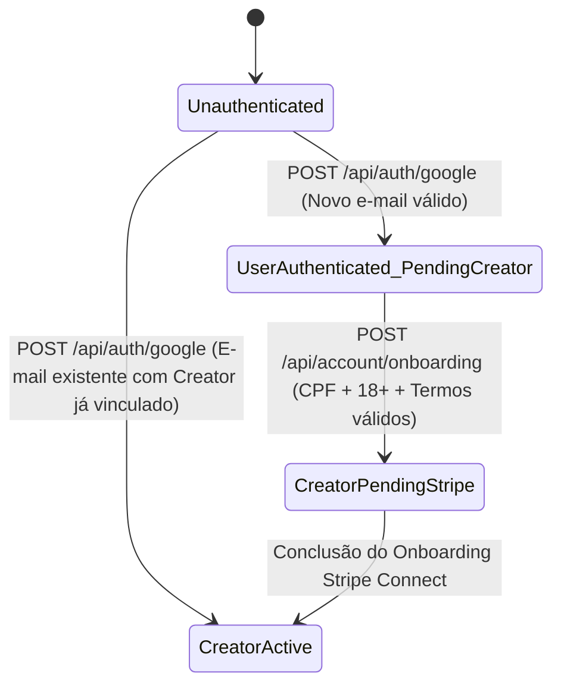

# Phase 1 Data Model: Autenticação via Google e Migração Completa para APIs (Sem Senhas)

**Feature**: `009-google-auth-api-migration`  
**Date**: 2026-10-19

---

## 1. Entidades Modificadas

### 1.1. `User` (`internal/auth/model/user.go`)

Representa a identidade autenticada via Google no sistema. Todos os campos relacionados a senha, recuperação de senha, verificação manual por token e sessão/CSRF de formulário SSR são removidos.

| Field | Type | Constraints / Tags | Description |
| ----- | ---- | ------------------ | ----------- |
| `ID` | `uint` | `gorm:"primarykey"` | Identificador interno primário (usado para comunicação entre módulos conforme Princípio V da Constituição) |
| `PublicID` | `string` | `json:"public_id" gorm:"type:varchar(40);uniqueIndex"` | Identificador público (`usr_...`) |
| `Username` | `string` | `json:"username" validate:"required"` | Nome de exibição do usuário (obtido inicialmente do perfil Google) |
| `Email` | `string` | `json:"email" validate:"required,email" gorm:"uniqueIndex"` | Endereço de e-mail único do usuário |
| `GoogleID` | `string` | `json:"google_id" gorm:"type:varchar(128);uniqueIndex"` | Identificador único e imutável da conta Google (`sub` claim do ID Token) |
| `EmailVerifiedAt` | `*time.Time` | `json:"email_verified_at"` | Data/hora em que o e-mail foi confirmado pelo Google |
| `TermsAcceptedAt` | `*time.Time` | `json:"terms_accepted_at"` | Data/hora de aceite dos termos de uso (preenchido na conclusão do onboarding de criador) |
| `Subscription` | `*subscription.Subscription` | `json:"subscription,omitempty" gorm:"foreignKey:UserID"` | Assinatura associada ao usuário |
| `CreatedAt` | `time.Time` | GORM default | Data de criação do registro |
| `UpdatedAt` | `time.Time` | GORM default | Data da última atualização |
| `DeletedAt` | `gorm.DeletedAt` | `gorm:"index"` | Soft delete |

**Campos Removidos de `User`**:
- `Password` (eliminado o armazenamento de senhas/hashes — `FR-002`)
- `PasswordResetToken` e `PasswordResetAt` (eliminado o fluxo de reset de senha — `FR-002`, `FR-003`)
- `EmailVerificationToken` (eliminado o fluxo de confirmação manual de e-mail — `FR-002`, `FR-003`)
- `CSRFToken` e `SessionToken` (substituídos por autenticação stateless via JWT Bearer — `FR-001`)

---

### 1.2. `Creator` (`internal/account/model/creator.go`)

Permanece com sua estrutura de domínio preservada, sendo criado na **Etapa 2 (Onboarding de Criador)** e vinculado ao `User` por meio de `UserID` (`uint`).

| Field | Type | Constraints / Tags | Description |
| ----- | ---- | ------------------ | ----------- |
| `ID` | `uint` | `gorm:"primarykey"` | Identificador interno do criador |
| `PublicID` | `string` | `json:"public_id" gorm:"type:varchar(40);uniqueIndex"` | Identificador público (`crt_...`) |
| `UserID` | `uint` | `json:"user_id" gorm:"uniqueIndex"` | Referência ao `User.ID` autenticado |
| `Name` | `string` | `json:"name"` | Nome civil completo validado |
| `SocialName` | `string` | `json:"social_name"` | Nome social / nome de exibição opcional |
| `CPF` | `string` | `json:"cpf" gorm:"uniqueIndex"` | CPF validado (11 dígitos numéricos + checksum) |
| `Email` | `string` | `json:"email"` | E-mail sincronizado com o `User.Email` |
| `Phone` | `string` | `json:"phone"` | Telefone de contato |
| `BirthDate` | `time.Time` | `json:"birth_date"` | Data de nascimento (deve comprovar idade >= 18 anos) |
| `StripeConnectAccountID` | `string` | `json:"stripe_connect_account_id"` | ID da conta conectada na Stripe |
| `OnboardingCompleted` | `bool` | `json:"onboarding_completed" gorm:"default:false"` | Indica conclusão do onboarding Stripe Connect |
| `PayoutsEnabled` | `bool` | `json:"payouts_enabled" gorm:"default:false"` | Indica habilitação de saques na Stripe |
| `ChargesEnabled` | `bool` | `json:"charges_enabled" gorm:"default:false"` | Indica habilitação de cobranças na Stripe |
| `OnboardingRefreshURL` | `string` | `json:"onboarding_refresh_url"` | URL de atualização do onboarding Stripe |
| `OnboardingReturnURL` | `string` | `json:"onboarding_return_url"` | URL de retorno do onboarding Stripe |
| `FacebookPixelID` | `string` | `json:"facebook_pixel_id"` | ID do Meta Pixel (opcional, 10–20 dígitos) |

---

## 2. DTOs de Entrada e Saída (Camada `model/` / `service/`)

### 2.1. Autenticação (`internal/auth/model/` e `internal/auth/service/`)

- **`GoogleAuthInput`**:
  - `IDToken string` (`json:"id_token"` — token OIDC retornado pelo Google)
- **`GoogleIdentity` (Claims validadas do Google)**:
  - `Sub string` (Google ID único)
  - `Email string`
  - `EmailVerified bool`
  - `Name string`
- **`AuthResponse`**:
  - `AccessToken string` (`json:"access_token"`)
  - `TokenType string` (`json:"token_type"` — `"Bearer"`)
  - `ExpiresIn int64` (`json:"expires_in"`)
  - `User UserSummaryDTO` (`json:"user"`)
  - `OnboardingRequired bool` (`json:"onboarding_required"` — `true` quando ainda não existe `Creator` vinculado ao `User.ID`)

### 2.2. Onboarding de Criador (`internal/account/service/dto.go`)

- **`InputOnboardingCreator`** (substitui `InputCreateCreator` sem campos `Password` / `PasswordConfirmation`):
  - `Name string` (`json:"name"` — obrigatório)
  - `SocialName string` (`json:"social_name"` — opcional)
  - `BirthDate string` (`json:"birthdate"` — obrigatório, `DD/MM/YYYY` ou `YYYY-MM-DD`, idade >= 18 anos)
  - `PhoneNumber string` (`json:"phone"` — obrigatório)
  - `CPF string` (`json:"cpf"` — obrigatório, 11 dígitos válidos)
  - `TermsAccepted bool` (`json:"terms_accepted"` — obrigatório `true`)

---

## 3. Transições de Estado da Conta do Usuário / Criador

1. **`Unauthenticated`**: Sem token Bearer válido (`401 Unauthorized` em rotas privadas).
2. **`UserAuthenticated_PendingCreator`**: `User` autenticado via Google (`EmailVerifiedAt != nil`), porém sem registro `Creator` correspondente (`onboarding_required = true`). Pode acessar `GET /api/auth/me`, `POST /api/auth/logout` e `POST /api/account/onboarding`; demais rotas de criador retornam `403 Forbidden` (`CREATOR_ONBOARDING_REQUIRED`).
3. **`CreatorPendingStripe`**: `Creator` criado, mas `NeedsOnboarding() == true` na Stripe. Pode acessar as rotas de `/stripe-connect/*` e `/api/auth/me`; rotas operacionais bloqueadas pelo `StripeOnboardingMiddleware` retornam `403 Forbidden` (`STRIPE_ONBOARDING_REQUIRED`).
4. **`CreatorActive`**: `User` + `Creator` completos, apto a operar todas as APIs do criador.
