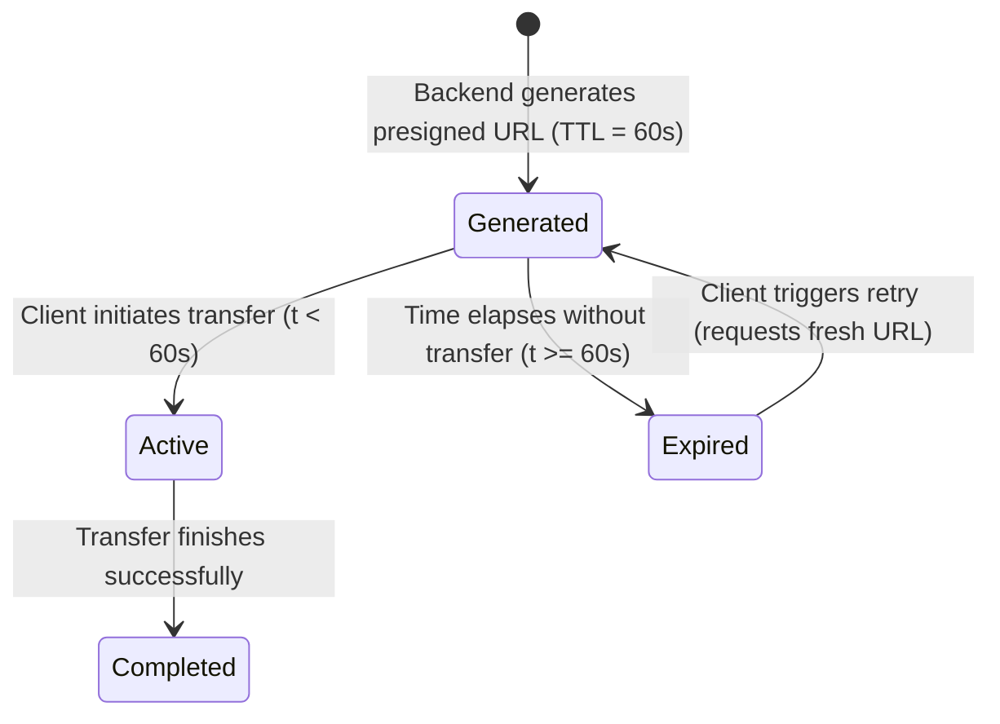

# Data Model: Reduce Presigned URL Expiration to 60 Seconds

**Feature**: `011-reduce-presigned-url-expiration`  
**Date**: 2026-10-23  

---

## 1. Entities & Transfer Objects

### `PresignedUploadResponse` (DTO)
Returned by the backend when an authenticated creator requests an upload URL.

| Field | Type | Description | Constraints / Value |
|---|---|---|---|
| `success` | `bool` | Indicates generation status | Always `true` on 200 OK |
| `upload_url` | `string` | Presigned S3 PUT URL | Includes SigV4 auth params (`X-Amz-Expires=60`) |
| `key` | `string` | Destination object key in bucket | Prefix `files/{creator_id}/{sanitized}-{uuid}.{ext}` |
| `method` | `string` | HTTP method for client upload | Strictly `"PUT"` |
| `headers` | `map[string]string` | Required headers for upload | Includes `"Content-Type": req.ContentType` |
| `expires_in` | `int` | Validity window in seconds | **Strictly `60`** (previously 900) |

---

### `File` (Library Model)
Domain entity representing an uploaded creator asset in PostgreSQL.

| Field | Type | Description | Transient / Persistent |
|---|---|---|---|
| `id` | `uint` | Primary key | Persistent |
| `creator_id` | `uint` | Owner identifier | Persistent |
| `name` | `string` | Display name of the file | Persistent |
| `s3_key` | `string` | Unique key in S3 bucket | Persistent |
| `file_type` | `string` | Extension/Type (e.g., `"pdf"`) | Persistent |
| `size` | `int64` | File size in bytes | Persistent |
| `s3_url` | `string` | Ephemeral signed GET URL | **Transient** (generated dynamically with **60s TTL**) |

---

## 2. Expiration Lifecycle & State Transitions

1. **Generation (t = 0s)**:
   - Backend calls `PresignPutObject` or `PresignGetObject` with `opts.Expires = 60 * time.Second`.
   - Client receives URL with query parameter `X-Amz-Expires=60` and `X-Amz-Date`.
2. **Active Transfer Window (0s < t < 60s)**:
   - Client opens connection to S3. AWS validates that current time `T_req` is within `[X-Amz-Date, X-Amz-Date + 60s]`.
   - Data transfer proceeds.
3. **Expiration (t >= 60s)**:
   - Any new HTTP connection attempt with that URL is rejected by AWS S3 with `403 Forbidden` (`Request has expired`).
   - Client handles 403 / failure and requests a fresh presigned URL.
