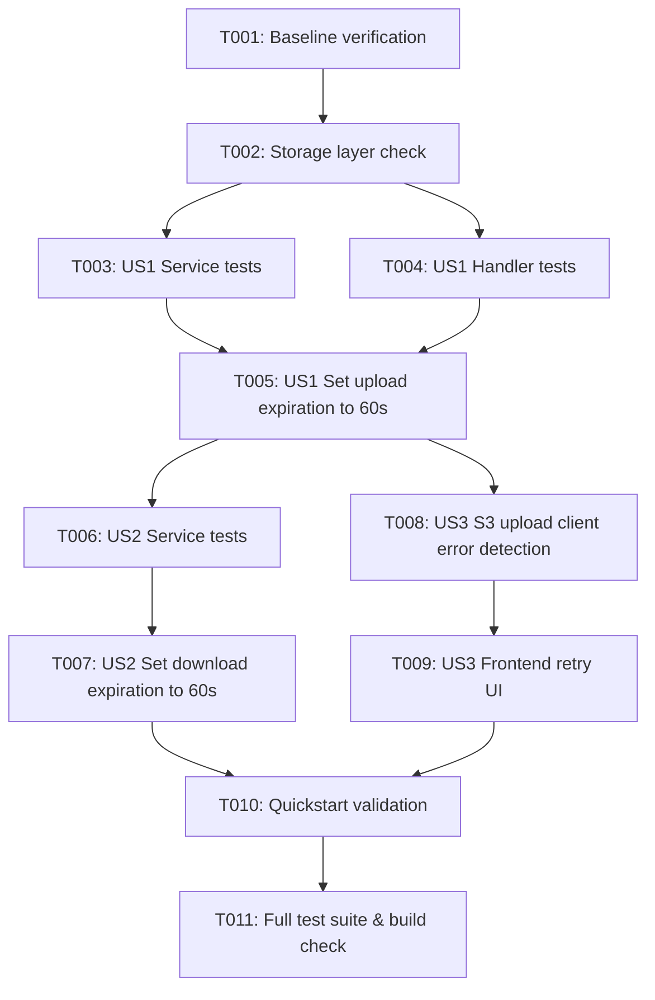

# Tasks: Reduce Presigned URL Expiration to 60 Seconds

**Input**: Design documents from `specs/011-reduce-presigned-url-expiration/`  
**Prerequisites**: `plan.md`, `spec.md`, `research.md`, `data-model.md`, `contracts/`, `quickstart.md`  

## Format: `[ID] [P?] [Story] Description with file path`

- **[P]**: Can run in parallel (different files, no dependencies)
- **[Story]**: Which user story this task belongs to (`[US1]`, `[US2]`, `[US3]`)
- Exact file paths included in all task descriptions

---

## Phase 1: Setup

**Purpose**: Baseline verification and environment readiness

- [ ] T001 Verify existing library service test suite passing in `internal/library/...`

---

## Phase 2: Foundational

**Purpose**: Shared storage layer expiration readiness

- [ ] T002 Verify `GeneratePresignedPutURL` and `GeneratePreviewLinkWithExpiration` in `pkg/storage/s3.go` accept and forward dynamic expiration durations

---

## Phase 3: User Story 1 - Secure Short-Lived Direct Upload Window (Priority: P1) 🎯 MVP

**Goal**: Configure presigned upload URLs (PUT) to expire strictly after 60 seconds (down from 900s), returning `expires_in: 60` in the DTO response.

**Independent Test**: Request an upload URL via `POST /file/upload-url`, assert `expires_in` is 60, initiate upload at t=5s (succeeds with 200 OK), and verify upload at t=65s fails with 403 Forbidden.

### Tests for User Story 1
- [ ] T003 [P] [US1] Update unit tests in `internal/library/service/file_service_test.go` to assert `expirationSeconds = 60` and `ExpiresIn: 60` in `TestFileService_GenerateUploadURL`
- [ ] T004 [P] [US1] Update handler test in `internal/library/handler/file_handler_test.go` to assert `expires_in: 60` in response payload

### Implementation for User Story 1
- [ ] T005 [US1] Update `expirationSeconds` constant from 900 to 60 in `internal/library/service/file_service.go` (`GenerateUploadURL`)

**Checkpoint**: User Story 1 (MVP) is fully functional and testable independently.

---

## Phase 4: User Story 2 - Secure Short-Lived File Download and Preview Access (Priority: P2)

**Goal**: Configure presigned preview and download URLs (GET) generated in library listing queries to expire strictly after 60 seconds (down from 300s).

**Independent Test**: Query `GET /files`, assert returned `s3_url` contains `X-Amz-Expires=60`, verify retrieval at t=5s succeeds with 200 OK, and confirm access at t=65s fails with 403 Forbidden.

### Tests for User Story 2
- [ ] T006 [P] [US2] Update unit tests in `internal/library/service/file_service_test.go` for `GetFilesByCreator` and `GetFilesByCreatorPaginated` asserting 60-second expiration duration passed to storage mock

### Implementation for User Story 2
- [ ] T007 [US2] Update expiration duration from `5 * time.Minute` to `60 * time.Second` in `internal/library/service/file_service.go` (`GetFilesByCreator` and `GetFilesByCreatorPaginated`)

**Checkpoint**: User Stories 1 and 2 work independently with 60-second expiration.

---

## Phase 5: User Story 3 - Expired Transfer Feedback and Immediate Recovery (Priority: P3)

**Goal**: Enhance frontend client to detect expired URLs, display friendly guidance, and allow instantaneous 1-click retry without losing form inputs.

**Independent Test**: Simulate an expired upload URL in the browser, verify user receives clear "Link expirado" feedback, click retry, and confirm a fresh URL is requested and file uploaded without re-selecting the file.

### Implementation for User Story 3
- [ ] T008 [P] [US3] Update error handling in `frontend/src/lib/s3-upload.ts` to detect 403 / expired URL errors and return clear expiration error messaging
- [ ] T009 [US3] Update `frontend/src/pages/files/FileLibraryPage.tsx` to preserve selected file and form fields on failure and provide immediate retry action

**Checkpoint**: All three user stories functional with seamless error recovery.

---

## Phase 6: Polish & Cross-Cutting Concerns

**Purpose**: End-to-end validation, documentation, and regression safety

- [ ] T010 Execute end-to-end validation scenarios documented in `specs/011-reduce-presigned-url-expiration/quickstart.md`
- [ ] T011 Run complete backend test suite (`go test ./...`) and frontend build check (`npm run build --prefix frontend`)

---

## Dependencies & Execution Order

### Parallel Opportunities

- **US1**: T003 (`file_service_test.go`) and T004 (`file_handler_test.go`) can run in parallel.
- **US2 vs US3**: Once US1 (MVP) is in place, US2 backend changes (T006, T007) and US3 frontend changes (T008, T009) can be developed in parallel.

---

## Implementation Strategy

1. **MVP First**: Deliver Phase 3 (User Story 1 - Upload URL expiration 60s). This immediately solves the primary attack surface for direct file uploads.
2. **Incremental Delivery**: Deliver Phase 4 (User Story 2 - Download URL expiration 60s) to reinforce library privacy.
3. **Resilience**: Deliver Phase 5 (User Story 3 - Frontend recovery and retry) to guarantee optimal UX under strict expiration windows.
